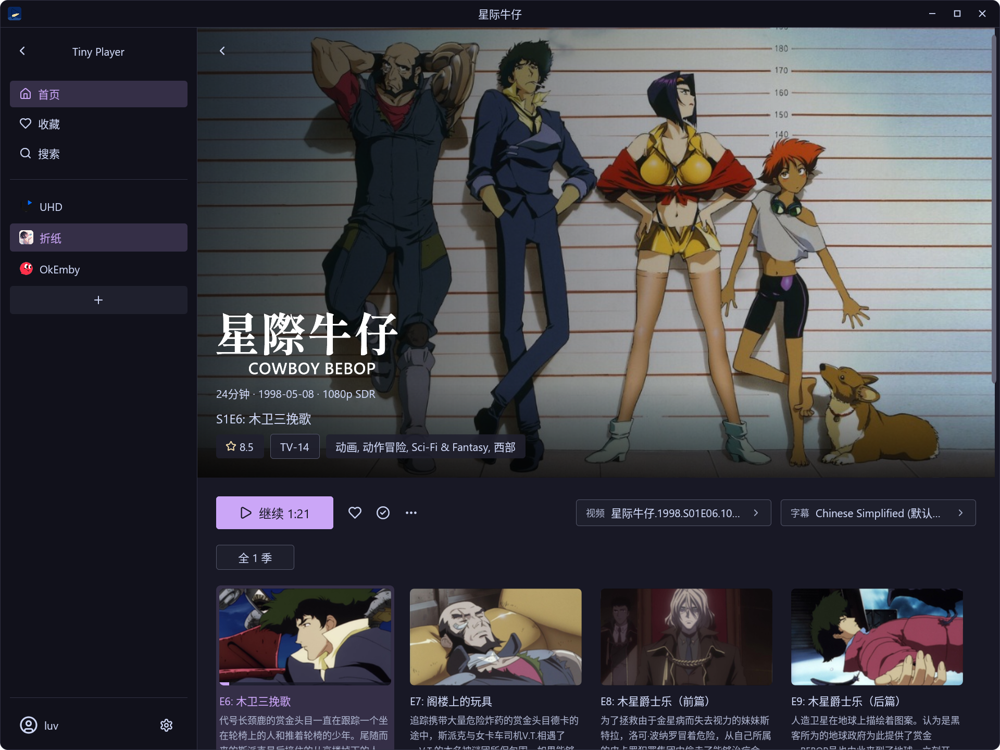
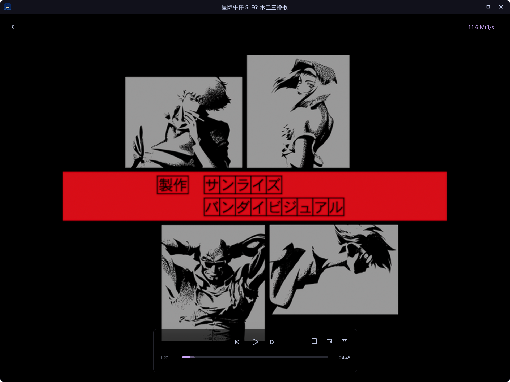

# Tiny Player

English | [简体中文](README.zh.md)

Tiny Player is a native Emby desktop client for Linux and Windows, built with Rust and GPUI. It uses FFmpeg for decoding, with Vulkan and libplacebo handling video rendering and color processing.

## Features

- **Multiple servers**: Add, edit, and switch between Emby servers, with server icons and media counts.
- **Library browsing**: Browse movie and TV posters, search, manage favorites, continue watching, and select seasons and episodes.
- **Media details**: View title logos, overviews, ratings, runtime, release dates, resolution, and dynamic range information.
- **Playback and track selection**: Choose video versions, audio tracks, and subtitles, set language preferences, and sync playback progress.
- **Video processing**: Software decoding, Vulkan hardware decoding, VA-API copyback or direct Vulkan mapping on Linux, and HDR tone mapping. Hardware decoding support depends on the GPU, driver, and video codec.
- **Playback controls**: Fullscreen, playback speed adjustment, subtitle positioning, a playback information overlay, and configurable memory and disk caches.
- **Gamepad playback shortcuts**: Standard gamepad buttons control playback, seeking, volume, speed, subtitle position, and returning to media details.
- **Keep awake during video playback**: Request inhibition of automatic screen locking, display power saving, and sleep; release the request when paused, buffering pauses playback, playback ends, or the player closes.

## Screenshots





## System Requirements

| Platform | Requirements |
| --- | --- |
| Linux prebuilt bundle | x86_64 GNU/Linux, glibc 2.39 or later, and a Wayland or X11 desktop session |
| Windows portable bundle | Windows 10 22H2 / Windows 11 x64, with a GPU and driver supporting Direct3D 11 |
| Video processing | A working Vulkan GPU driver, including when software decoding is used |

The Linux prebuilt bundle includes FFmpeg, libplacebo, and selected dependencies. The system must also provide a Vulkan loader, ALSA and audio configuration, Fontconfig, FreeType, fonts, XKB keyboard data, system CA certificates, and GCC/C++ runtime libraries compatible with Ubuntu 24.04 (GCC 13) or later. The glibc 2.39 baseline applies to the prebuilt bundle; requirements for other builds depend on their build environment and dependencies.

The Windows portable bundle includes multimedia dependencies and a Vulkan loader. The system must provide the GPU's Vulkan driver. Running the portable bundle does not require Rust, Python, Visual Studio, or a separate FFmpeg installation.

The Linux bundle also requires host `libva.so.2`, `libva-drm.so.2`, and `libdrm.so.2` compatible with Ubuntu 24.04 or later. VA-API needs a compatible host driver and device access; optionally set `TINY_VAAPI_DEVICE=/dev/dri/renderD128`. User Auto tries Vulkan first on Linux NVIDIA GPUs and VA-API mapping first on other Linux GPUs, followed by the other GPU path and software decoding. Development settings retain **Force VA-API (copyback)** and include copyback before software in their Auto policy; `TINY_HWDEC=vaapi` and `auto-copy` select these development modes. Windows retains Vulkan followed by software. See [decoder settings](docs/settings.md) and [hardware verification](docs/playback-engine.md).
For the GPU performance path, select **Force VA-API (map to Vulkan)** or use `TINY_HWDEC=vaapi-vulkan`. This imports NV12/P010 through DMA-BUF without downloading the decoded YUV frame. It requires Vulkan external memory, DRM modifiers and synchronization support; forced-mode failures are reported, and copyback remains selectable in development settings. Final BGRA output still returns to CPU memory for GPUI.

On Linux, playback idle inhibition requires `xdg-desktop-portal` and a desktop portal backend that implements the Inhibit interface. If the desktop rejects the request, playback continues and the failure is logged. Manual locking and user-initiated sleep remain controlled by the system.

## Installation

### Arch Linux

Build and install using the repository's [PKGBUILD](PKGBUILD):

```sh
sudo pacman -S --needed base-devel git
git clone https://github.com/Clwury/tiny-player.git
cd tiny-player
makepkg -si
```

`makepkg` installs the declared build and runtime dependencies. Once installed, launch Tiny Player from your desktop application menu or run:

```sh
tiny-player
```

### Linux Prebuilt Bundle

For **x86_64 (64-bit Intel/AMD) GNU/Linux with glibc 2.39 or later**. Download `tiny-player-<version>-linux-x86_64.tar.gz` from [the latest GitHub release](https://github.com/Clwury/tiny-player/releases/latest).

Extract the complete archive and run the application. Replace `<version>` with the version of the downloaded bundle:

```sh
tar -xzf "tiny-player-<version>-linux-x86_64.tar.gz"
./tiny-player/bin/tiny-player
```

You can also install it for the current user without `sudo`:

```sh
./tiny-player/install.sh
```

The installer uses the fixed location `~/.local/tiny-player.app`, creates a launcher symlink at `~/.local/bin/tiny-player`, and adds a desktop menu entry. To update, close Tiny Player, extract the new bundle into a fresh directory, and run its installer without arguments. It replaces the application, refreshes the launcher, desktop entry and icons, and restores the previous installation if an update fails. User settings and caches are preserved.

To build the prebuilt bundle yourself, set up Docker on an x86_64 Linux host and run the following from the repository root:

```sh
./scripts/package-linux.sh
```

By default, the tar.gz, AppImage, their SHA256 files, and build manifest are written to `dist/` from the same audited payload. See the [Linux packaging guide](docs/linux-packaging.md) for details.

#### AppImage

Alternatively, download `tiny-player-<version>-linux-x86_64.AppImage` and its `.sha256` file from the same release. Replace `<version>` with the downloaded version:

```sh
sha256sum --check "tiny-player-<version>-linux-x86_64.AppImage.sha256"
chmod +x "tiny-player-<version>-linux-x86_64.AppImage"
./tiny-player-<version>-linux-x86_64.AppImage
```

Without FUSE, use extraction mode:

```sh
./tiny-player-<version>-linux-x86_64.AppImage --appimage-extract-and-run
```

The static musl runtime does not require `libfuse2`, but normal AppImage mounting still requires working FUSE. The application still requires **glibc 2.39 or later** and the same host Vulkan loader/driver, audio configuration, fonts, Wayland/X11 session and desktop portal support described above. Software decoding still requires Vulkan for rendering; AppImage does not bundle GPU drivers or bypass portal requirements.

Double-click launching, automatic desktop menu installation and automatic updates are not guaranteed. To update, close Tiny Player and replace the AppImage file. AppImage and tar.gz builds share the existing user settings and cache locations; settings are not stored beside the AppImage.

### Windows Portable Bundle

For **Windows 10 22H2 / Windows 11 x64 (64-bit Intel/AMD)**. Download `tiny-player-<version>-windows-x86_64.zip` from [the latest GitHub release](https://github.com/Clwury/tiny-player/releases/latest).

Extract the complete `tiny-player-<version>-windows-x86_64.zip` archive (`<version>` is the downloaded bundle's version) and double-click `tiny-player.exe`. Keep the entire directory together when moving the application, including its DLLs and `share/` resources. Settings and caches are stored in your Windows user profile.

Building the bundle requires the Rust MSVC toolchain, Visual Studio 2022 C++ x64 Build Tools, the Windows SDK, and 64-bit Python 3.12. Run the following in PowerShell from the repository root:

```powershell
.\scripts\package-windows.ps1
```

The script prepares native dependencies and generates the application directory and ZIP in `dist/`. See the [Windows packaging guide](docs/windows-packaging.md) for environment setup, offline builds, and validation commands.

### Running from Source

The workspace contains the root `tiny-player` application and the
[`tiny-playback` engine](crates/tiny-playback). Playback pages and Emby integration
stay in the application. See [the engine boundary](docs/playback-engine.md) for
module ownership and build details. The engine has no GPUI dependency; the application
adapts its video and subtitle pixels for display. Run `cargo test --workspace --locked` to test
both crates, or `cargo test -p tiny-playback --locked` for engine tests.

Application UI ownership and repeatable boundary checks are documented in
[Application UI boundaries](docs/application-ui-boundaries.md). The original spec,
audit, and migration record are kept under `docs/refactors/application-ui-business/`.

After cloning the repository, prepare the following dependencies for Linux development:

- Stable Rust, C/C++ build tools, Clang/libclang, and pkg-config.
- FFmpeg 8.1 or 9.x, libplacebo 7.x, and their development headers.
- Vulkan headers, a loader, and a GPU driver, along with ALSA, Wayland/X11, and other dependencies listed in [PKGBUILD](PKGBUILD).

FFmpeg 9 can create internally synchronized Vulkan queues. These require libplacebo
API 365 with the queue import fixes. If the system provides an older libplacebo,
prepare the same pinned snapshot as the Linux release bundle:

```sh
python3 -B scripts/prepare-linux.py
```

This requires Python 3 with Jinja2, Git, Ninja, shaderc and LittleCMS development packages. It builds
libplacebo under `target/linux-native/` and generates the ignored `.cargo/config.toml`
so Cargo uses matching headers and runtime libraries. If Meson is missing, its
pinned source release is downloaded locally. Existing unrelated Cargo configuration
is preserved. System libraries are not replaced. Use `cargo run --release --locked`
to launch optimized builds with this local environment.

Run from the repository root:

```sh
cargo run --locked
```

To build an optimized version:

```sh
cargo build --release --locked
./target/release/tiny-player
```

For Windows development, meet the Windows build requirements above, then prepare the dependencies and local Cargo configuration:

```powershell
.\scripts\package-windows.ps1 -Mode Prepare
cargo run --locked
```

Use `--client-name "My Player"` (or `--client-name=MyPlayer`) to set the client name
reported to Emby. It defaults to `Tiny Player` when omitted or empty. For example:

```sh
cargo run --locked -- --client-name "My Player"
```

## Playback Controls and Keyboard Shortcuts

These shortcuts are active when the playback page has keyboard focus:

The keyboard and information icons to the right of the cache speed toggle keyboard and gamepad shortcut help and playback information. Both overlays share the same position; opening either closes the other. Keys appear as italic tags with a translucent accent color background. Key combinations use `-`, and alternative keys for the same action appear in separate tags with `/` between them. Descriptions follow the interface language.

The wheel adjusts volume over the top-right icons and overlays whose content fits. When overlay content exceeds the visible height, the wheel scrolls the content without changing volume, including at the scroll boundaries.

| Key | Action |
| --- | --- |
| `Space` / `P` | Play / pause |
| `F` | Toggle fullscreen |
| `Esc` | Close the episode list if open; otherwise exit fullscreen, or return to media details when windowed |
| `←` / `→` | Seek backward / forward 5 seconds |
| `↓` / `↑` | Seek backward / forward 60 seconds |
| `j` / `Shift` + `J` | Cycle to the next / previous subtitle track, including Off |
| `v` | Show / hide subtitles while keeping the selected track |
| `#` | Cycle audio tracks, including Off (usually `Shift` + `3`) |
| `<` / `>` | Previous / next playlist episode (usually `Shift` + `,` / `.`) |
| `Enter` | Next playlist episode |
| `F8` | Show / hide the playlist (episode list) |
| `9` / `/` | Decrease volume by 2 percentage points |
| `0` / `*` | Increase volume by 2 percentage points |
| `M` | Mute / unmute |
| `[` | Divide playback speed by 1.1 |
| `]` | Multiply playback speed by 1.1 |
| `{` / `}` | Halve / double playback speed (usually `Shift` + `[` / `]`) |
| `Backspace` | Reset playback speed to 1× |
| `R` / `T` | Move subtitles up / down by 1% of the displayed video height |
| `I` | Show / hide playback information |

Playback speed ranges from **0.25× to 4×**. Volume shortcuts also support the numeric keypad's divide and multiply keys. Holding a volume or speed adjustment key repeats the adjustment. Holding an arrow key repeats seeking: left and right seek 5 seconds per repeat, while up and down seek 60 seconds per repeat. Playback, fullscreen, mute, subtitle and playlist visibility, track switching, and episode switching run once per press. Episode switching stops at the first and last playlist entries without wrapping.

After a successful subtitle or audio track change through a shortcut or menu, “Subtitles: track name” or “Audio: track name” appears beside the Back button in the theme accent color for two seconds. Further changes update the name and restart the timer. Disabling a track displays Off.

Mouse controls over the playback area:

| Action | Effect |
| --- | --- |
| Double-click the video with the left mouse button | Toggle fullscreen |
| Right-click the video | Play / pause |
| Scroll up / down | Increase / decrease volume |
| Click or drag the progress bar | Seek to the selected position |

Seeking while paused displays the frame at the selected position and keeps playback paused. Seeking to the video end displays the final frame and finishes loading. Resuming continues from the current position.

In fullscreen, mouse movement anywhere in the playback area reveals the controls. They hide after one second without movement, except while hovering over the controls or top-right icons, dragging the progress bar, or viewing the episode list.

### Gamepad Playback Controls

Gamepads are detected automatically on the playback page. The active playback window accepts input from the first controller used, until that controller disconnects. On Steam Deck, add Tiny Player to Steam and use a standard gamepad layout in Steam Input.

| Button (Deck / Xbox layout) | Action |
| --- | --- |
| A | Play / pause |
| B | Close the episode list, track/cache menu, or information/shortcut overlay; otherwise return to media details |
| ← / → | Seek backward / forward 5 seconds |
| ↓ / ↑ | Lower / raise volume by 2 percentage points |
| LB / RB | Seek backward / forward 60 seconds |
| X | Toggle mute |
| Y | Toggle playback information |
| Menu / Start | Toggle fullscreen |
| View / Select | Show / hide playback controls |
| LT / RT | Decrease / increase playback speed |
| L3 | Reset playback speed to 1× |
| R3-↑ / R3-↓ | Hold R3 to raise / lower subtitle position |

L3 / R3 refer to clicking the left / right stick, and arrows refer to the D-pad. The playback shortcut overlay also includes the full gamepad button reference. After gamepad button input, gamepad help appears above keyboard help for the current playback page.

Seeking and volume repeat while held; other actions require a new press. Input stops when the window loses focus or playback closes. Playback controls remain visible for three seconds after gamepad actions. B closes open menus; their item selection and media browsing continue to use the existing mouse/keyboard interface. Keyboard shortcuts retain their existing mappings.

Linux source builds also require the libudev development package (`libudev-dev` on Ubuntu; `systemd-libs` on Arch). The user session must have access to the controller's `/dev/input/event*` device.

## License

This project is licensed under the **GNU General Public License v3.0 or later (GPL-3.0-or-later)**. See [LICENSE](LICENSE) for the full terms. Third-party dependencies retain their respective licenses.

## Acknowledgments

Thanks to the following projects and applications for their foundations, implementation references, and design inspiration:

- [Zed / GPUI](https://github.com/zed-industries/zed)
- [gpui-kit](https://github.com/longbridge/gpui-kit)
- [Tsukimi](https://github.com/tsukinaha/tsukimi)
- [mpv](https://github.com/mpv-player/mpv)
- [Lenna](https://lennaapp.github.io/)

icons come from [lige47/lige_icon (离歌图标库)](https://github.com/lige47/lige_icon)
